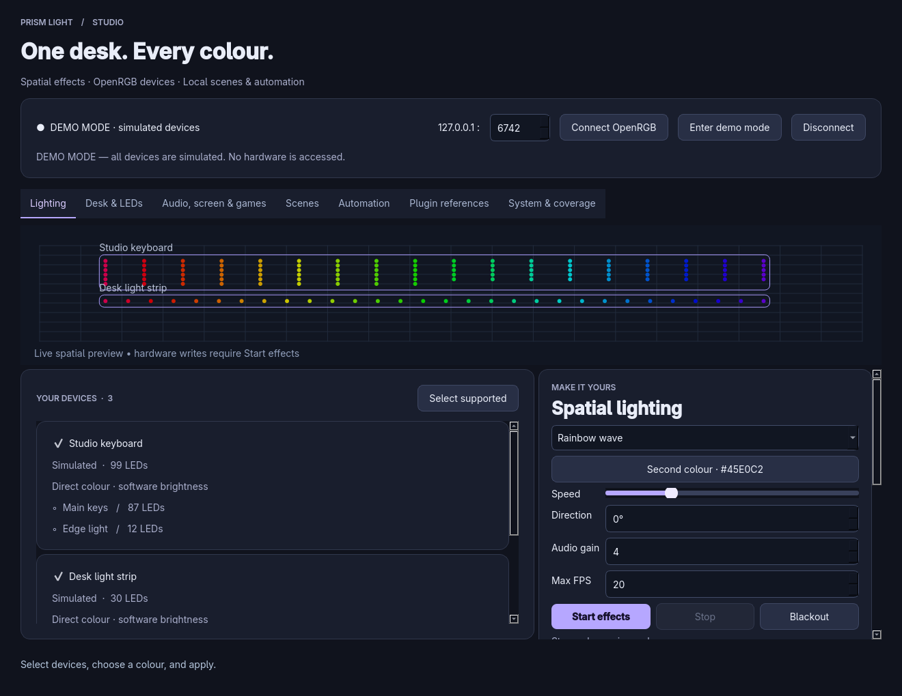

# Prism Light Studio

An independent RGB desktop studio for **Windows and Linux**, extending the original Prism Light app. OpenRGB supplies hardware detection and access through its localhost SDK server; Prism Light supplies spatial effects, desk layouts, painted LEDs, scenes and lighting automation.



This is a working development build, **not full SignalRGB feature parity**. The coverage table below and **System & coverage** inside the app show the gaps. SignalRGB's recovered files informed the architecture and plugin-contract research. Its binaries, graphics, QML and device code are not bundled or executed. The optional importer indexes names and USB IDs from your locally supplied recovered ZIP; it does not make those plugins compatible drivers.

## Run on Linux

Extract `PrismLight-Studio-linux.zip` and run `./PrismLight/PrismLight`. Keep the whole folder together. Add `--demo` for simulated devices. The local portable bundle targets this build machine's Linux/glibc environment; other distributions have not been validated.

From source:

```sh
python3 -m venv .venv
.venv/bin/python -m pip install -r requirements.txt
.venv/bin/python main.py --demo
```

Or use `./Run-PrismLight.sh --demo` after setup.

## Run or build on Windows

Install 64-bit Python 3.12–3.14 with its launcher. Extract the source kit, then double-click **Demo-Windows.cmd** or **Run-PrismLight.cmd**. Setup creates a virtual environment and installs the pinned dependency on first use.

Double-click **Build-Windows.cmd** on Windows to test and build `dist/PrismLight-windows.zip`, containing `PrismLight.exe` and its support files. Keep the whole portable folder together. **This Studio revision has not yet been built or run on Windows.** The previous foundation EXE is not this Studio release. PyInstaller builds Windows executables on Windows; the supplied Linux binary is not a Windows EXE.

The GitHub Actions workflow runs Windows and Ubuntu tests/builds on pushes and pull requests, and can also be started manually. Check the current workflow run for platform validation and downloadable artifacts.

## Connect hardware

1. Install [OpenRGB](https://openrgb.org/) and check which devices it detects. Follow its platform-specific device/permission setup.
2. Start OpenRGB's **SDK Server**, normally port **6742**. Keep OpenRGB running; use localhost binding where configurable.
3. In Prism Light choose **Connect OpenRGB** and select devices. Devices must advertise Direct/Custom per-LED color support. Unsupported/ambiguous devices remain disabled.
4. Select an effect, colors, brightness and speed. **Start effects** streams lighting. **Stop** leaves the last frame. **Blackout** sends black after any current write.
5. Arrange devices in **Desk & LEDs**, or edit X/Y, width, height, rotation and grid columns. Save a scene to keep the arrangement.

One effect controller should drive a device at a time. SDK v3 writes have no hardware acknowledgement: sent does not mean a physical LED was verified. Hotplug/rescan invalidates indexed device control and requires reconnecting. Prism Light does not change LED counts, write firmware, install drivers or control fan/pump speeds.

## Feature coverage

| Feature | Current implementation |
|---|---|
| Hardware RGB | OpenRGB SDK v3, IPv4 localhost, solid colors and independent per-LED frames |
| Effects | 17: solid, rainbow wave, gradient, breathing, color cycle, scanner, comet, twinkle, fire, plasma, ripple, checkerboard, audio pulse, audio spectrum, screen ambience, CPU meter, game event |
| Spatial layout | Drag, rotate, grid/strip mapping in normalized desk coordinates |
| LED painting | Enable Paint LEDs, click an LED with primary color; right-click erases its override |
| Scenes | Atomic local storage, demo/hardware scopes, layout and paint, JSON import/export, five starter looks |
| Audio | Opt-in selected Qt input; RMS and eight frequency probes, not a full FFT analyzer |
| Screen ambience | Opt-in 24 × 14 color grid via Qt; Windows/X11 route, no Wayland portal adapter |
| Automation | Opt-in time-of-day and running-executable rules that load saved scenes |
| Game/app events | Authenticated loopback HTTP color-event input for user-written adapters |
| Monitoring | Windows/Linux CPU/memory; Linux hwmon temperature and fan RPM if readable |
| Recovered plugins | Inert metadata index from a user-supplied ZIP/JS file; no plugin runtime or driver port |
| Legacy presets | Original solid-color presets retained |
| Not implemented | Cooling control, LCD drivers, native SignalRGB plugin runtime, packaged game-specific adapters, arbitrary OS/key macros, cloud marketplace/account sync, paid content, remote/mobile control |

Hardware compatibility comes from OpenRGB and the conservative Direct-mode check. Imported script counts do not equal controllable devices. Preview draws at most about 1,200 points per device; full lighting frames are sent. The selected FPS is a maximum request rate; busy-worker frames are dropped and actual hardware FPS is unmeasured.

## Audio and screen

Enable sources in **Audio, screen & games**. Audio can use a microphone or an OS-provided monitor/loopback input. This app does not install or create speaker loopback. Muted, inaccessible or unsupported sources may produce black reactive output. Loading a scene does not enable capture.

Screen capture includes visible content on the chosen display and stays in local memory. Portal-only Wayland desktops may return no image; the app reports this and stops capture. No audio/screen recording is saved. Stop each source explicitly when finished.

## Game/app API

Click **Start local event input**, then select **Game event** and start effects. The app shows its ephemeral localhost port and session token. Example for a local game mod/script:

```python
import json
from urllib.request import Request, urlopen
request = Request(
    'http://127.0.0.1:PORT/event',
    data=json.dumps({'color': '#FF6F91'}).encode(),
    headers={'Authorization': 'Bearer TOKEN', 'Content-Type': 'application/json'},
    method='POST',
)
with urlopen(request, timeout=2) as response:
    assert response.status == 204
```

Copy PORT/TOKEN from the app. Events fade over two seconds. This API only accepts colors, not executable actions. It binds IPv4 localhost, requires a token, bounds request/queue sizes and has no browser CORS interface. Stop local input to close it. Game-specific telemetry adapters are not included.

## Storage and automation

`studio.json` is stored beside the original `presets.json`: `%APPDATA%\PrismLight\` on Windows; `$XDG_CONFIG_HOME/PrismLight/` or `~/.config/PrismLight/` on Linux. Corrupt files are preserved and reported. Scene imports are validated as data and never executed.

Device identities use name/vendor/serial/location. Missing, unsupported or ambiguous devices are skipped; USB relocation can require updating a scene. Scene import/export includes those local identity hashes.

Automation is off at startup. Enable it each session. Time rules fire once during a matching minute while the app is open, without replaying missed times. Application rules match a running executable name (Windows tasklist / Linux proc comm), not the foreground window. They fire on entry into a match and do not restore previous scenes on process exit. Capture sources need separate enabling. Rules from the other demo/hardware scope are ignored; later simultaneous matches take precedence.

## Tests and builds

```sh
QT_QPA_PLATFORM=offscreen .venv/bin/python -m unittest discover -s tests -v
QT_QPA_PLATFORM=offscreen .venv/bin/python main.py --smoke-test
.venv/bin/python build.py
```

See [validation](docs/VALIDATION.md) for results. Tests cover TCP framing, per-LED packet content, topology errors, invalid frames, effect bounds, blackout, scenes, inert plugin parsing, authenticated HTTP events, automation and GUI streaming.

Original code is GPL-3.0-only. OpenRGB remains a separately installed GPLv2 program. Retain [third-party notices](THIRD_PARTY_NOTICES.md) and licenses. This is a local development package, not a public release or a SignalRGB-affiliated product. Earlier foundation documentation is retained in [FOUNDATION.md](docs/FOUNDATION.md); the table above describes current capabilities.
