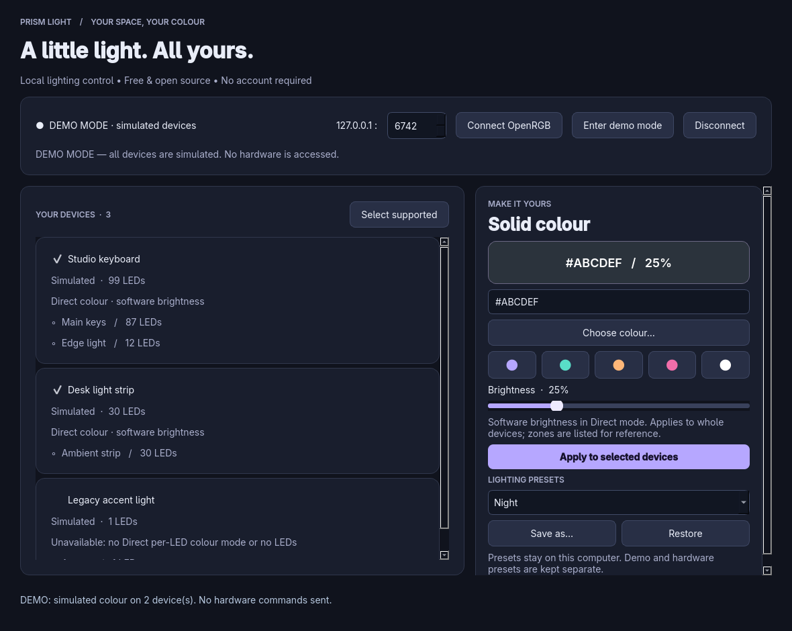

# Prism Light

An original personal RGB lighting desktop app. Free software, local only: no subscriptions, accounts, telemetry or cloud service. This first version uses solid colour with software brightness. It does not control fans or pumps. Donations can be added as a voluntary external link when the maintainer chooses a destination; no payment flow or donation URL has been invented.



## Stack and integration

Python 3.12+ and Qt Widgets through PySide6 give us native desktop windows, accessible standard controls, a polished dark interface and a Windows packaging route. The UI and preset storage are separate from a small original SDK transport. Socket work runs on a serial worker thread so a failed connection does not freeze the interface. No browser runtime is needed.

OpenRGB is a **separate program**, connected only over documented TCP SDK packets on `127.0.0.1`. Hardware detection and device drivers remain in OpenRGB. This project neither links nor copies its controller code and does not bundle OpenRGB. The client requests SDK protocol **3** (OpenRGB 0.7+); newer servers negotiate down. Older servers fail with a helpful error. Current protocol 6 features, segments, zone effects and mode-specific-only devices are outside this foundation.

Official source and SDK docs inspected before implementation:

- https://gitlab.com/CalcProgrammer1/OpenRGB
- https://gitlab.com/CalcProgrammer1/OpenRGB/-/blob/master/Documentation/OpenRGBSDK.md
- Inspected revision: `4e7aa49d68aca6c959eb2a9b48a6d6fc35f744a6`
- Local reference checkout: `../openrgb-upstream` (not needed to run).
- License and integration notes: [THIRD_PARTY_NOTICES.md](THIRD_PARTY_NOTICES.md).

## Windows quick start

Prism Light has a Windows desktop build. Choose the portable app or run the source. OpenRGB is needed only for real devices; demo mode works by itself.

### Download the portable Windows app

1. Open [Windows builds on GitHub Actions](https://github.com/danny19862025/prism-light/actions/workflows/windows.yml).
2. Select the latest **successful** run. Under **Artifacts**, download **PrismLight-windows-prototype**. GitHub may require signing in to download a build artifact; Prism Light itself has no account or sign-in.
3. Extract the downloaded artifact. If it contains `PrismLight-windows.zip`, extract that ZIP too. Open the extracted `PrismLight` folder and double-click **PrismLight.exe**.
4. Click **Enter demo mode** to try the simulated devices, or start OpenRGB's SDK server and click **Connect OpenRGB**.

Keep `PrismLight.exe` and the `_internal` folder together. Do not run the app from inside a ZIP or copy only the `.exe`. The portable build includes Python and Qt, so you do not need to install Python. This prototype is unsigned. Build availability and check results are shown in Actions; a successful build does not establish compatibility with your RGB hardware.

### Run the source on Windows

1. Install **64-bit Python 3.12 or newer** from [python.org](https://www.python.org/downloads/windows/), including the Python launcher.
2. [Download the source ZIP](https://github.com/danny19862025/prism-light/archive/refs/heads/main.zip) and extract it, or clone the repository:

   ```powershell
   git clone https://github.com/danny19862025/prism-light.git
   cd prism-light
   ```

3. Double-click **Demo-Windows.cmd** to try the simulated devices. On first run it creates `.venv` and installs the dependencies. Internet access is needed for this setup.
4. Double-click **Run-PrismLight.cmd** for normal startup. For real lighting, follow **Connect OpenRGB** below.

You can also run these launchers from PowerShell:

```powershell
.\Demo-Windows.cmd
.\Run-PrismLight.cmd
```

Manual setup, if preferred:

```powershell
py -3 -m venv .venv
.\.venv\Scripts\python.exe -m pip install -r requirements.txt
.\.venv\Scripts\python.exe main.py --demo
```

Omit `--demo` for normal startup. Demo is always explicitly labelled, never contacts hardware, and includes two controllable simulated devices and one unsupported simulated device. You do not need to activate the virtual environment or change PowerShell execution policy. To reinstall dependencies, run `Setup-Windows.cmd` from a terminal.

### Linux development

```sh
git clone https://github.com/danny19862025/prism-light.git
cd prism-light
python3 -m venv .venv
.venv/bin/python -m pip install -r requirements.txt
.venv/bin/python main.py --demo
```

No internet is required at runtime. Initial dependency and OpenRGB downloads require internet.

## Connect OpenRGB

1. Install OpenRGB from https://openrgb.org and follow its Windows device/driver setup instructions. Open it and check which devices and zones it actually detects. This app cannot add support for hardware that OpenRGB does not detect.
2. Open OpenRGB's **SDK Server** tab. Start the server on port **6742**. Keep OpenRGB running. You may instead launch OpenRGB with `--server --server-port 6742`.
3. In Prism Light, click **Connect OpenRGB**. The address is intentionally fixed to IPv4 localhost. Change the port if necessary. If OpenRGB has an address-binding option, use `127.0.0.1`; remote access is unnecessary.
4. Select a single device's checkbox to apply to only that device; select multiple to apply to them together. Choose a colour or enter `#RRGGBB`, set brightness, then click **Apply to selected devices**. Changes are explicit, not streamed while dragging.
5. A device must advertise a mode named **Direct** or **Custom** with per-LED colour support and at least one LED/colour slot. Others remain listed with disabled controls and a reason. Mode names outside this conservative allowlist are currently unsupported even if similar hardware might be controllable.
6. Brightness is explicitly **software dimming**: multiply each RGB channel by the percentage. Native brightness is set to the Direct mode maximum when advertised, to avoid double dimming. This is lighting intensity, not electrical power or thermal control. At 0%, RGB is black.

Zones are listed with LED counts; this first version colours the whole selected device. No LED count changes, zone resizing, firmware writes or profile-save commands are sent. Applying a colour switches supported devices to their Direct mode. On disconnect or exit, the last lighting may remain; previous hardware effects are not automatically restored.

The UI checks the SDK connection every four seconds and before applying. A device-list notification or count change invalidates control and requires reconnecting. Do not rescan or hotplug while applying: protocol 3 uses positional device IDs and cannot make topology changes atomic with a write. Device lighting writes have no hardware acknowledgement in protocol 3: **sent** means bytes were sent, not that a physical LED has been verified.

## Named presets

Select devices, choose colour and brightness, then **Save as…**. This saves the editor settings and selected device identities. **Restore** loads the colour, brightness and selection; **Apply** sends them. Missing, unsupported and ambiguous devices are skipped. Presets match name, vendor, serial and location rather than a device's temporary list index; a changed USB location may require resaving. Identical devices without unique identities are disabled to avoid restoring to the wrong device.

- Windows: `%APPDATA%\PrismLight\presets.json`
- Linux: `$XDG_CONFIG_HOME/PrismLight/presets.json`, falling back to `~/.config/PrismLight/presets.json`.

Writes use a temporary file, flush and atomic replacement. Demo and hardware presets have separate scopes in this file. Names are unique across scopes; replacing a name requires confirmation. Corrupt or unknown-format files are preserved and an actionable error is displayed. Back up or rename a corrupt file to start fresh. This version assumes one running instance when saving presets.

## Build a Windows app

Double-click **Build-Windows.cmd** in the extracted source folder. It installs dependencies, runs tests, builds the executable, checks packaged demo startup, and creates `dist/PrismLight-windows.zip`. Python 3.12+ and internet access for the initial downloads are required. A failure stops the build and leaves its error visible.

Alternatively, run these commands on Windows in the project folder:

```powershell
py -3 -m venv .venv
.\.venv\Scripts\python.exe -m pip install -r requirements-build.txt
.\.venv\Scripts\python.exe -m unittest discover -s tests -v
.\.venv\Scripts\python.exe build.py
.\dist\PrismLight\PrismLight.exe --demo
```

The result is a portable **folder** at `dist/PrismLight/`. Keep the entire folder together. Python need not be installed on the destination machine. Build on Windows for Windows; PyInstaller does not cross-compile Windows executables on Linux. The [GitHub Actions workflow](https://github.com/danny19862025/prism-light/actions/workflows/windows.yml) runs on Windows for every push and pull request, tests the Windows launcher, builds the `.exe`, checks packaged demo startup and uploads the portable ZIP. You can also start it with **Run workflow**. Use the latest successful run for downloads. Public distribution must retain the included notices, licenses and corresponding source; see third-party notices. This prototype is unsigned.

## Checks

```sh
.venv/bin/python -m unittest discover -s tests -v
```

14 tests passed on Linux and on a Windows GitHub Actions runner with Qt's offscreen platform. The [initial Windows run](https://github.com/danny19862025/prism-light/actions/runs/43362783469) also built the executable and passed packaged demo startup:


- Real localhost TCP framing against a fake SDK server, protocol negotiation to v3, device and zone decoding, and RGB/update-mode encoding.
- Connection refused, timeout, server disconnect, invalid magic, old protocol and truncated data.
- Device-list notification blocks stale indexed writes.
- Unsupported devices produce no lighting packets; demo performs no network access.
- Named preset persistence across store instances, overwrite, scope, invalid values and corrupt-file preservation.
- Qt demo interaction, colour/brightness restore, unsupported-device UI, empty inventory, mock live connection and connection failure messaging.

A visual capture was inspected and the layout corrected. `docs/demo.png` is the actual Qt demo interface, not a design mockup. `--smoke-test` launches the labelled demo and exits after verifying basic UI startup, useful for packaged builds.

**Requires your Windows PC:** run the packaged executable; check scaling at 100%, 150% and 200%, keyboard navigation and colour dialog; connect to your actual OpenRGB server; verify device/zone names, colour order, dimming from 0–100%, single and multi-device application, disconnect/reconnect, restarting the app and restoring presets, and behaviour on unplug/rescan. Windows CI has verified automated tests, packaging and offscreen demo startup. Your Windows desktop appearance and physical hardware have not been verified. The fake server is a protocol test fixture, not OpenRGB itself.

## Troubleshooting

- **Windows source launcher cannot find Python:** install 64-bit Python with its launcher, then reopen the terminal and run `Setup-Windows.cmd`.
- **Portable app is missing files:** fully extract the ZIP and keep the `.exe` beside `_internal`.
- **Connection refused:** start OpenRGB's SDK server and check its port matches. OpenRGB must accept IPv4 localhost connections.
- **Timeout or invalid packet:** verify the port belongs to OpenRGB, not another service. SDK v3+ is required.
- **No devices:** inspect OpenRGB detection, permissions and supported-device documentation; reconnect after detection completes.
- **Unavailable device:** v1 has no suitable Direct mode for that device. Do not interpret a detected device as verified compatibility.
- **Colour sent but no visible change:** verify Direct mode in OpenRGB, brightness and active competing RGB applications. Test using OpenRGB first. Do not run multiple effect controllers on the same device.

## License

Original Prism Light code: GPL-3.0-only. Copyright (C) 2026 Prism Light contributors. See [LICENSE](LICENSE). OpenRGB remains independently GPLv2 licensed. This is an independent project and does not use SignalRGB code, graphics or branding. The name Prism Light is a working project name; no trademark clearance is asserted.
