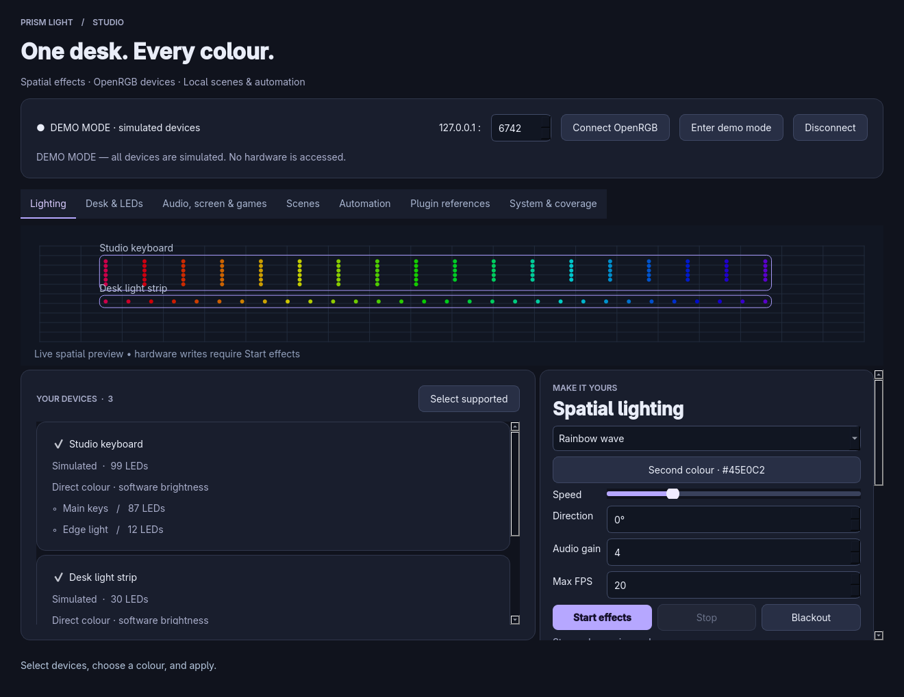
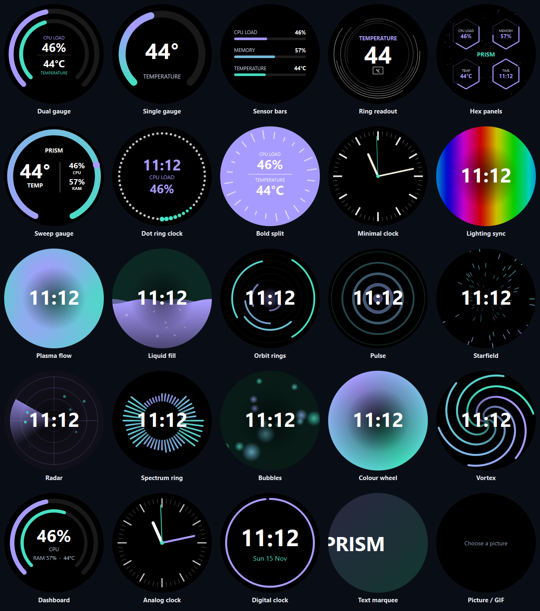
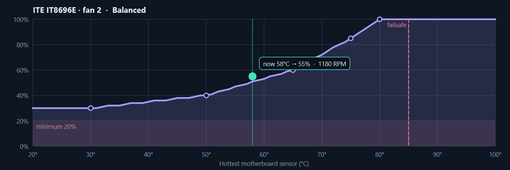

# Prism Light Studio

An independent RGB desktop studio for **Windows and Linux**, extending the original Prism Light app. Prism Light includes OpenRGB 1.1 as its hardware engine and manages device discovery automatically. No separate OpenRGB installation, server startup or connection step is needed. Spatial effects, desk layouts, painted LEDs, scenes and lighting automation share one interface.



This is a working development build, **not full SignalRGB feature parity**. The coverage table below and **System & coverage** inside the app show the gaps. SignalRGB's recovered files informed the architecture and plugin-contract research. Its binaries, graphics, QML and device code are not bundled or executed. The optional importer indexes names and USB IDs from your locally supplied recovered ZIP; it does not make those plugins compatible drivers.

## Prism Monitor (hardware stats widget)

`PrismMonitor.exe` is a separate Windows 11 desktop widget for live CPU/GPU/RAM temperatures, load, clocks, power and per-game FPS. See [docs/MONITOR.md](docs/MONITOR.md). Run from source with `.venv\Scripts\python monitor_main.py` (or **Run-PrismMonitor.cmd**). Build the installer `dist/PrismMonitor-Setup-<version>.exe` (needs Inno Setup 6) and the portable `dist/PrismMonitor-windows.zip` with `.venv\Scripts\python build_monitor.py`.

## Run on Linux

Extract `PrismLight-Studio-linux.zip` and run `./PrismLight/PrismLight`. Keep the whole folder together. Add `--demo` for simulated devices. The local portable bundle targets this build machine's Linux/glibc environment; other distributions have not been validated.

From source:

```sh
python3 -m venv .venv
.venv/bin/python -m pip install -r requirements.txt
.venv/bin/python tools/fetch_openrgb.py
.venv/bin/python main.py --demo
```

Or use `./Run-PrismLight.sh --demo` after setup.

## Run or build on Windows

Start with **Install-Windows.cmd** in the source or portable Windows package. Windows setup now installs the official PawnIO 2.2.0 prerequisite when its service is absent. It downloads directly from the upstream release and checks its pinned SHA-256 and Authenticode publisher before opening the official installation wizard. Complete the wizard and approve the Windows administrator prompt. Cancelled or failed driver setup stops installation and can be retried. Existing PawnIO installations are retained. Internet is required for the first driver download.

Use **Run-PrismLight.cmd** for source hardware sessions or **Install-Windows.cmd** for packaged hardware sessions: these launch with administrator privileges so OpenRGB can use PawnIO. Opening the packaged EXE directly still requires **Run as administrator** for motherboard/RAM access. Demo and smoke-test source launches skip driver installation and elevation. Build-Windows.cmd uses `Setup-Windows.cmd --no-driver`, so building does not install a kernel driver. Restart Windows if the PawnIO installer requests it. Installing the prerequisite does not guarantee support for every RGB device.

Install 64-bit Python 3.12–3.14 with its launcher. Extract the source kit, then double-click **Demo-Windows.cmd** or **Run-PrismLight.cmd**. Setup creates a virtual environment, installs the pinned dependency and downloads the checksum-pinned hardware runtime on first use.

Double-click **Build-Windows.cmd** on Windows to test and build `dist/PrismLight-windows.zip`, containing `PrismLight.exe` and its support files. Keep the whole portable folder together. **This Studio revision has not yet been built or run on Windows.** The previous foundation EXE is not this Studio release. PyInstaller builds Windows executables on Windows; the supplied Linux binary is not a Windows EXE.

The GitHub Actions workflow runs Windows and Ubuntu tests/builds on pushes and pull requests, and can also be started manually. Check the current workflow run for platform validation and downloadable artifacts.

## Desktop layout

The Discover page has a searchable, categorized gallery of the 37 included effects and a five-page spotlight carousel. Select **Use effect** to open its lighting editor. The left sidebar opens scenes, lighting/devices, layouts, macros, monitoring, audio/screen inputs and protocol references. **Hardware** expands discovery controls and diagnostics. The bottom playback bar stays visible across pages and controls play/pause, previous/next effect, blackout and brightness.

## Automatic hardware discovery

Open Prism Light normally. It starts its bundled hardware engine in the background and lists detected devices. Choose an effect and press Play. **Devices** shows the inventory; **Scan devices** releases and restarts only Prism Light's own engine to refresh discovery. Demo mode does not start hardware discovery.

The engine is a separate bundled process, runs as your user, uses a private loopback port and is stopped when Prism Light closes. It does not connect to or shut down a separately installed OpenRGB server. You do not need to configure a port. Stop competing RGB controllers before controlling the same device.

On Linux, USB/I2C access can still require a one-time system udev-rule installation. Bundling software cannot grant kernel permissions. **Hardware → Hardware diagnostics** shows the engine log and can copy a setup command for your terminal. Install the rules, reconnect USB devices, and scan again. On Windows, the default setup opens the official PawnIO installer when needed; driver installation requires the user's Windows administrator approval.

Only devices exposing supported Direct/Custom per-LED modes are enabled. A running engine with zero devices means discovery completed without visible supported hardware, not that physical compatibility has been established. SDK writes have no physical acknowledgement. **Stop** leaves the last frame; **Blackout** sends black. No firmware writes are sent by Prism Light. Fan header writes happen only on the **Fans** page after you change a header from Auto (BIOS) (see below). The only LED-count change is the one you request: motherboard addressable (ARGB) headers report 0 LEDs until you enter how many LEDs are connected under **Devices → Addressable headers** and press **Set**. The bundled engine saves that count for future sessions.

## Feature coverage

| Feature | Current implementation |
|---|---|
| Hardware RGB | Bundled OpenRGB 1.1, automatic discovery, private local transport, solid colors and independent per-LED frames |
| Effects | 37 total: the original 17 plus digital rain, rain, snowfall, fireflies, ocean waves, lava lamp, watercolor, Voronoi cells, neon tunnel, galaxy, meteor shower, fireworks, lightning storm, candy stripes, sunset, fire and ice, radar, kaleidoscope, audio bars and audio rings |
| Expanded effect controls | Scale 25–400% and density 1–100% where supported; old scenes retain defaults |
| Spatial layout | Drag, rotate, grid/strip mapping in normalized desk coordinates |
| LED painting | Enable Paint LEDs, click an LED with primary color; right-click erases its override |
| Scenes | Atomic local storage, demo/hardware scopes, layout and paint, JSON import/export, five starter looks |
| Audio | Opt-in selected Qt input; RMS and eight frequency probes, not a full FFT analyzer |
| Screen ambience | Opt-in 24 × 14 color grid via Qt; Windows/X11 route, no Wayland portal adapter |
| Automation | Opt-in time-of-day and running-executable rules that load saved scenes |
| Game/app events | Authenticated loopback HTTP color-event input for user-written adapters |
| Monitoring | Windows/Linux CPU/memory; Linux hwmon temperature and fan RPM if readable |
| Fan control | Windows, administrator: motherboard fan headers on ITE IT8686E/IT8688E/IT8689E/IT8696E/IT8628E via PawnIO; Auto (BIOS), fixed speed or Quiet/Balanced/Performance curves; GIGABYTE secondary IT87952E monitored only |
| AIO display | CORSAIR Nautilus LCD Cap (1b1c:0c57/0c55): gallery of 25 original effects (8 info blocks, lighting sync, ambient, motion, audio, clocks, text, picture/GIF) with colours, speed, centre overlay, brightness and rotation |
| Recovered plugins | Inert metadata index from a user-supplied ZIP/JS file; no plugin runtime or driver port |
| Legacy presets | Original solid-color presets retained |
| Not implemented | Pump control over USB, other LCD models, native SignalRGB plugin runtime, packaged game-specific adapters, arbitrary OS/key macros, cloud marketplace/account sync, paid content, remote/mobile control |

Hardware compatibility comes from OpenRGB and the conservative Direct-mode check. Imported script counts do not equal controllable devices. Preview draws at most about 1,200 points per device; full lighting frames are sent. The selected FPS is a maximum request rate; busy-worker frames are dropped and actual hardware FPS is unmeasured.

## Audio and screen

Enable sources in **Audio, screen & games**. Audio can use a microphone or an OS-provided monitor/loopback input. This app does not install or create speaker loopback. Muted, inaccessible or unsupported sources may produce black reactive output. Loading a scene does not enable capture.

Screen capture includes visible content on the chosen display and stays in local memory. Portal-only Wayland desktops may return no image; the app reports this and stops capture. No audio/screen recording is saved. Stop each source explicitly when finished.

## Game/app API

Click **Start local event input**, then select **Game event** and start effects. The app shows its ephemeral localhost port and session token. Example for a local game mod/script:

```python
import json
from urllib.request import Request, urlopen
request = Request(
    'http://127.0.0.1:PORT/event',
    data=json.dumps({'color': '#FF6F91'}).encode(),
    headers={'Authorization': 'Bearer TOKEN', 'Content-Type': 'application/json'},
    method='POST',
)
with urlopen(request, timeout=2) as response:
    assert response.status == 204
```

Copy PORT/TOKEN from the app. Events fade over two seconds. This API only accepts colors, not executable actions. It binds IPv4 localhost, requires a token, bounds request/queue sizes and has no browser CORS interface. Stop local input to close it. Game-specific telemetry adapters are not included.

## Storage and automation

`studio.json` is stored beside the original `presets.json`: `%APPDATA%\PrismLight\` on Windows; `$XDG_CONFIG_HOME/PrismLight/` or `~/.config/PrismLight/` on Linux. Corrupt files are preserved and reported. Scene imports are validated as data and never executed.

Device identities use name/vendor/serial/location. Missing, unsupported or ambiguous devices are skipped; USB relocation can require updating a scene. Scene import/export includes those local identity hashes.

Automation is off at startup. Enable it each session. Time rules fire once during a matching minute while the app is open, without replaying missed times. Application rules match a running executable name (Windows tasklist / Linux proc comm), not the foreground window. They fire on entry into a match and do not restore previous scenes on process exit. Capture sources need separate enabling. Rules from the other demo/hardware scope are ignored; later simultaneous matches take precedence.

## Tests and builds

```sh
QT_QPA_PLATFORM=offscreen .venv/bin/python -m unittest discover -s tests -v
QT_QPA_PLATFORM=offscreen .venv/bin/python main.py --smoke-test
.venv/bin/python build.py
```

See [validation](docs/VALIDATION.md) for results. Tests cover TCP framing, per-LED packet content, topology errors, invalid frames, effect bounds, blackout, scenes, inert plugin parsing, authenticated HTTP events, automation and GUI streaming.

Original code is GPL-3.0-only. OpenRGB 1.1 is bundled as a separate GPL-licensed process, with its exact source archive, upstream license, asset hashes and provenance manifest in `hardware/openrgb/`. Retain [third-party notices](THIRD_PARTY_NOTICES.md) and licenses. This is a local development package, not a public release or a SignalRGB-affiliated product. Earlier foundation documentation is retained in [FOUNDATION.md](docs/FOUNDATION.md); the table above describes current capabilities.

## Bundled engine provenance and build checks

`tools/fetch_openrgb.py` prepares the platform runtime under ignored `vendor/openrgb/`. It downloads OpenRGB 1.1 x86-64 assets from the official release links, verifies fixed SHA-256 hashes, and includes the matching source archive at commit `8e16de27858cf2be6af54a33ce003df74cb9fd3e`. Linux uses an extracted AppImage, so FUSE is unnecessary. Windows uses the portable ZIP. `build.py` prepares the runtime automatically and copies it into the portable app. Source kits include the fetch tool; first setup/build needs internet, normal use does not download dependencies.

`--hardware-smoke-test` checks native engine startup, SDK discovery and cleanup without lighting writes. `--hardware-config PATH` can isolate its settings for testing. `--smoke-test` remains a hardware-free demo check for CI. The current engine bundle supports x86-64 Linux/Windows builds only. Windows packaging and real hardware still need verification on the target machine.

## Expanded effect collection

The twenty new renderers and their thumbnail images are original Prism Light implementations. The public SignalRGB Marketplace and its Discover/customization documentation were reviewed for broad visual styles and organization; no SignalRGB scripts, paid content, game integrations or storefront images are shipped. See [effect research](docs/EFFECT-RESEARCH.md) for sources and the new effect list. New cards appear first in Discover; search matches display titles, effect names and descriptions. Scale and density are saved in scenes; older scene files remain compatible.

## Fans

Open **Fans** and press **Start fan control** (Prism Light must run as administrator, e.g. through **Run-PrismLight.cmd**). Every header starts on **Auto (BIOS)** and is only read. Choose **Fixed** or a curve per header to control it; curves follow the hottest motherboard sensor. Tick **Pump** on the header your AIO pump uses.

Safety limits: fans never drop below 20 % and pump headers below 70 %. If a board sensor reaches 85 °C, sensors stop reading, a controlled fan stops spinning, or the hardware reports an error, the affected headers (or all of them) are written back to their saved BIOS settings. **Stop**, switching a header to Auto and closing Prism Light restore the original registers. If Windows or Prism Light is killed abruptly, the last speed stays until restart, when the BIOS takes over again. Close other fan tools (FanControl, SignalRGB, GIGABYTE Control Center) before starting. The register map follows LibreHardwareMonitor; hardware access uses the PawnIO LpcIO module bundled with OpenRGB.

## AIO display

Open **AIO display**, pick an effect from the gallery (live previews, filter by category), adjust colours, speed and the centre overlay, then press **Show on AIO**. Info blocks show CPU load, memory and the hottest motherboard temperature; temperatures need **Fans → Start fan control** (read-only monitoring is enough). Your choice is remembered.  Close iCUE and SignalRGB first. **Stop display** hands the screen back to its built-in picture. Protocol per OpenLinkHub's Nautilus LCD driver; only display commands are sent.

## CPU, GPU and FPS on the AIO display

* **GPU temperature and load** (AMD Radeon) come from the installed AMD driver. No setup.
* **CPU temperature** (AMD Ryzen Tctl, as shown by Ryzen Master/HWiNFO) is read through the signed PawnIO AMDFamily17 module and needs administrator rights (Run-PrismLight.cmd). Without it, blocks fall back to the hottest motherboard sensor.
* **FPS** comes from Intel PresentMon, started only while a block or overlay shows FPS. It measures the game in the foreground window and needs administrator rights.

The **Fans** page also draws a diagram of the selected header: its curve or fixed speed, the minimum-speed floor, the 85 °C failsafe and the live operating point. 

## Running in the background

Closing the Prism Light window hides it to the system tray (notification area). The AIO display, fan control and lighting keep running. Click the tray icon to open the window again, or right-click it and choose **Quit Prism Light** to stop everything: quitting hands the AIO screen back to its built-in picture and returns all fans to BIOS control. Starting Prism Light again while it is running just brings the existing window forward, so two copies never control the same hardware.

## Start with Windows and resume

Tick **Start with Windows** (Devices → Hardware bar, or the tray icon menu). Prism Light then starts hidden in the tray about 20 seconds after you sign in, with administrator rights and no UAC prompt each time (a Windows Task Scheduler logon task named "Prism Light", without the default three-day time limit). Untick it to remove the task.

Prism Light remembers what was running (playing lighting effect and its scene, AIO display, fan control and each header's mode) every few seconds and when you quit, and restores it on the next start. Demo sessions never overwrite it.

## iCUE widgets for the AIO screen

Prism Light's info blocks are also available as iCUE widgets, so iCUE itself can drive the pump LCD (no Prism Light needed while iCUE runs). Build them with:

```sh
.venv/Scripts/python tools/build_icue_widgets.py
```

This writes nine `.icuewidget` files to `dist/icue-widgets/` (Game HUD, Dual Gauge, Single Gauge, Sensor Bars, Ring Readout, Hex Panels, Sweep Gauge, Dot Ring Clock, Bold Split). Double-click one, or in iCUE open the cooler's **Widgets** page, press **+** and pick the file. Each widget has colour, animation-speed and sensor settings in iCUE; temperatures, loads and FPS come from iCUE's own Sensors and FPS providers. Requires iCUE 5.52 or newer. Only one program can drive the screen: stop Prism Light's AIO display while iCUE shows a widget. Source: `icue-widgets/src/prism-blocks.js`.
